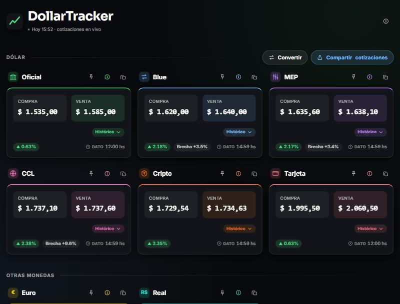
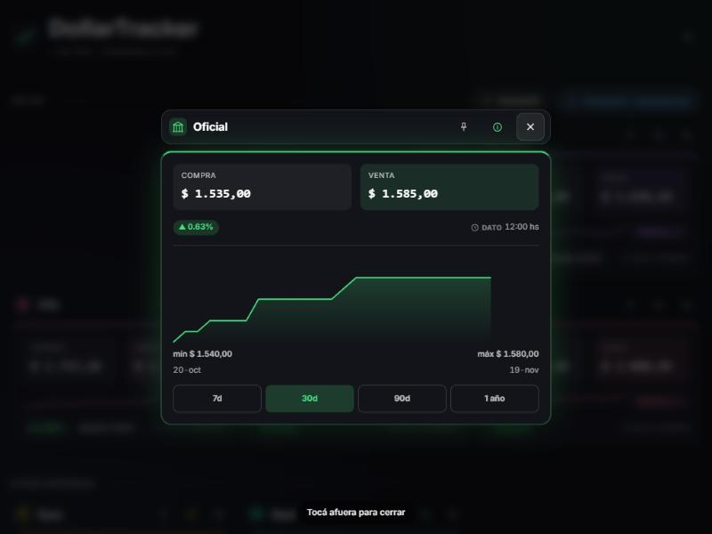

# DollarTracker

[Read in English](README.md)

Una PWA que muestra las cotizaciones del dólar, el euro y el real en
Argentina, el riesgo país y una selección de mercados internacionales en una
sola pantalla, con histórico y sin registrarse.


App en producción: <https://dollartracker.vercel.app>




## Funcionalidades

- Cotizaciones del dólar: oficial, blue, MEP, CCL, cripto y tarjeta.
- Cotizaciones del euro y el real brasileño.
- Riesgo país y mercados internacionales: petróleo, oro, S&P 500, Dow Jones,
  Nasdaq, Ibovespa y Merval (vía ETFs de referencia para los índices).
- Futuros de soja y maíz (vía ETFs de referencia).
- Precios cripto: BTC, ETH, SOL y XRP.
- Histórico por tarjeta (7d / 30d / 90d / 1 año), con compartir y copiar.
- Cotizador que convierte un monto contra todas las cotizaciones a la vez.
- Página SEO propia por cotización (`/dolar-blue`, `/dolar-mep`, etc.),
  generada en el build, más soporte offline como PWA instalable.

## Stack

- Frontend: React 19, TypeScript 5.9, Vite 7.
- Backend: Vercel Edge Functions (TypeScript), usadas solo como proxy de
  Twelve Data.
- Datos: APIs públicas de DolarAPI, ArgentinaDatos, Twelve Data, Binance y
  CriptoYa. Sin base de datos propia.
- Testing: Vitest 4.
- Deploy: Vercel.

## Cómo correrlo localmente

```bash
npm install
npm run dev
```

| Variable | Requerida | Para qué sirve |
| --- | --- | --- |
| `TWELVE_DATA_API_KEY` | Solo para las tarjetas de Mercados | Ver `.env.example` |
| `VITE_DISABLE_ANALYTICS` | No | Apaga la analítica en el build |

## Tests

```bash
npm test
```

Corre la suite de Vitest: tests unitarios y de componentes que cubren la
obtención de datos y sus reintentos, el caché offline, la conversión de
monedas, el formato y los componentes principales de la interfaz.

## Estructura del proyecto

```
dollartracker/
├── api/        Edge Functions de Vercel (proxy de Twelve Data)
├── docs/       Documentación extendida
├── public/     Assets estáticos e íconos de la PWA
├── scripts/    Scripts de build (generador de imagen OG)
├── src/        App de React: components, hooks, lib, config
└── vercel.json Config de deploy, headers de seguridad y CSP
```

## Más documentación

- [Arquitectura](docs/architecture.md): fuentes de datos, caché, páginas por
  cotización, testing.
- [Despliegue](docs/deployment.md): variables de entorno, headers de
  seguridad, imagen OG, SEO.

## Autor

Benjamín Espina

[LinkedIn](https://linkedin.com/in/benjamin-espina) ·
[GitHub](https://github.com/benjaespina98) ·
[Portfolio](https://benjaminespina.com)

## Licencia

MIT, ver [LICENSE](LICENSE).
