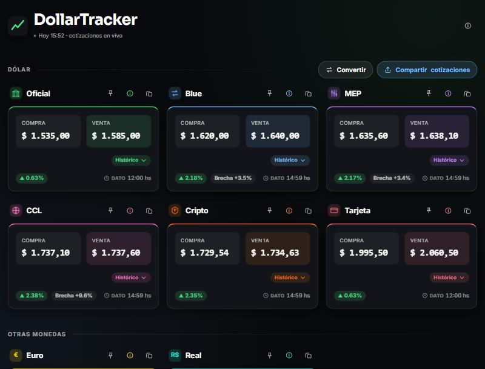
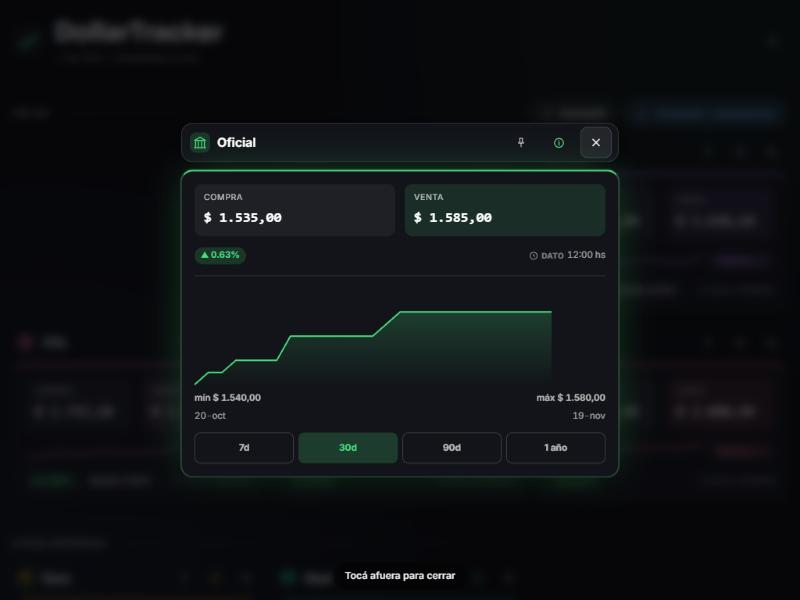

# DollarTracker

[Leer en español](README.es.md)

A PWA that shows Argentina's dollar, euro and real exchange rates, country
risk and a selection of international markets on one screen, with history
and no sign-up.


Live app: <https://dollartracker.vercel.app>




## Features

- Dollar rates: oficial, blue, MEP, CCL, cripto and tarjeta.
- Euro and Brazilian real quotes.
- Country risk and international markets: oil, gold, S&P 500, Dow Jones,
  Nasdaq, Ibovespa and Merval (ETF proxies for the indices).
- Soybean and corn futures (ETF proxies).
- Crypto prices: BTC, ETH, SOL and XRP.
- Per-card history (7d / 30d / 90d / 1 year), with share and copy.
- Converter that checks one amount against every rate at once.
- SEO landing page per quote (`/dolar-blue`, `/dolar-mep`, etc.), generated
  at build time, plus offline support as an installable PWA.

## Stack

- Frontend: React 19, TypeScript 5.9, Vite 7.
- Backend: Vercel Edge Functions (TypeScript), used only as a Twelve Data
  proxy.
- Data: DolarAPI, ArgentinaDatos, Twelve Data, Binance and CriptoYa public
  APIs. No own database.
- Testing: Vitest 4.
- Deploy: Vercel.

## Running locally

```bash
npm install
npm run dev
```

| Variable | Required | Purpose |
| --- | --- | --- |
| `TWELVE_DATA_API_KEY` | Only for the Markets cards | See `.env.example` |
| `VITE_DISABLE_ANALYTICS` | No | Disables analytics in the build |

## Tests

```bash
npm test
```

Runs the Vitest suite: unit and component tests covering data fetching and
retries, offline caching, currency conversion, formatting, and the main UI
components.

## Project structure

```
dollartracker/
├── api/        Vercel Edge Functions (Twelve Data proxy)
├── docs/       Extended documentation
├── public/     Static assets and PWA icons
├── scripts/    Build scripts (OG image generator)
├── src/        React app: components, hooks, lib, config
└── vercel.json Deploy config, security headers and CSP
```

## More documentation

- [Architecture](docs/architecture.md): data sources, caching, per-quote
  pages, testing.
- [Deployment](docs/deployment.md): environment variables, security headers,
  OG image, SEO.

## Author

Benjamín Espina

[LinkedIn](https://linkedin.com/in/benjamin-espina) ·
[GitHub](https://github.com/benjaespina98) ·
[Portfolio](https://benjaminespina.com)

## License

MIT, see [LICENSE](LICENSE).
